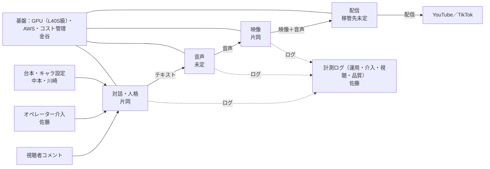

# 片岡HD 技術ロードマップ

配信の流れを部品に分けて担当を決め，資金ロードマップの関門に合わせて技術を進める計画です．

- 2026年10月24日版（たたき台）．担当は次回のミーティングで確定します
- Slack: #20-pj-kataoka-hd ／ メンバー向け資料
- 関連：[資金ロードマップ](funding-roadmap.md)，[コンテンツロードマップ](content-roadmap.md)

## まず押さえること

- **配信の流れを7つの部品に分け，部品ごとに担当を置きます．** 各自が自分の部品を単独で動かし，直せる状態を目指します．
- **片岡くんはアーキテクトとして，全体設計・部品間の取り決め・統合とレビューを担当します．** 実装は各部品の担当に任せます．
- **技術MVP（12月）の合格条件に「片岡くん抜きで1回配信できること」を入れます．** 体制が分担できているかを測る指標です．

> **最初の区切り：11月中旬** 構成図・README・部品間の取り決めを揃え，担当を確定します．

## いまの課題

これまで片岡くんが一人で全体を作ってきたことで，短い期間で配信まで到達できました．次の段階では，同じやり方のままだと開発の速さが一人の時間で頭打ちになります．

- 全体の構成が文書になっておらず，部品だけを受け持つことが難しい状態です．
- メンバー間で理解度に差があり，「説明するより自分でやる方が早い」状態が続いています．
- タスクが口頭で渡されていて，誰が何をしているかが見えません．

## 配信の流れと担当

入力は対話・人格に集まり，テキスト → 音声 → 映像の順に渡って配信されます．部品の間を流れるもの（矢印）の形式を決めるのが片岡くんの役割です．各部品は基盤の上で動き，ログは計測に集まります．

| 部品 | 担当（案） | 入力→出力／役割 | 現状 | 研究テーマ例 |
|---|---|---|---|---|
| 対話・人格 | 片岡くん | コメント・介入・台本 → 発話テキスト | LLMはAPI．ハドルの議事録から小板AIを試作済み | 配信者らしさを保つ人格の一貫性 |
| 音声 | 未定（募集） | 発話テキスト → 音声 | Irodori-TTS，Style-Bert-VITS2を試用 | 低遅延の音声合成と声質 |
| 映像 | 片岡くん | 音声 → 顔と体の映像 | AVTR-1で生成．口の動きの調整は片岡くんが進める | ― |
| 配信 | 片岡くんから移管（担当未定） | 映像＋音声 → YouTube／TikTok | 自律発話と人間介入の配信を試行 | 長時間配信の安定化と自動復旧 |
| 基盤 | 金谷くん | すべての部品を動かすGPU・AWS環境とコスト管理 | L40S級（AWS g6e）を検討中．今のGPUでは約1.5倍の処理能力が不足 | スポットインスタンス上のリアルタイム配信基盤 |
| 介入・計測 | 佐藤くん | オペレーターの操作と各部品のログ → 評価データ | 未着手 | 人の介入の効果測定 |
| コンテンツ | 中本さん・川崎さん | キャラ設定と台本（中本さん），SNS運用（川崎さん） | 未着手 | 話題の設計と視聴者の反応 |

担当は案です．担当する部品を各自の研究テーマにつなげると，担当が定着しやすくなります．

## 片岡くんの役割：アーキテクト

### 担当すること

- 全体の設計と，部品の追加・入れ替えの判断
- 部品間の取り決め（入力と出力の形式）の決定
- 部品の統合と，各担当のコードレビュー
- 対話・人格と映像（口の動きを含む）の部品の実装

### 引き継ぎで用意するもの

1. **構成図1枚：** 部品と，その間を流れるデータの形式
2. **README：** 各部品の起動方法と必要な環境
3. **30分の画面録画：** 配信を立ち上げるまでの操作

構成図とREADMEの下書きは，Claude Codeでリポジトリから起こせば負担を小さくできます．

## 進め方

- **コードは研究室のGitHubに集約します．** 個人のPCにしかないコードや設定をなくします．
- **タスクはGitHub Issuesに1〜3日単位で書き，担当を付けます．** 片岡くんはプルリクエストのレビューで全体を把握します．
- **週1回30分の技術定例を，事業の打合せとは別に設けます．** 各部品の進み具合と，部品間の取り決めの変更だけを話します．
- **各部品はダミーの入力で単独で動かせるようにします．** GPUや全体の環境がなくても，自分の部品を開発・テストできます．

## 技術ロードマップ

フェーズ1・2は，資金ロードマップの関門1・2と同じ時期に合わせています．

| フェーズ | 時期 | ゴール | 終わりの目安 |
|---|---|---|---|
| 0. 分解と引き継ぎ（いまここ） | 〜2026年11月中旬 | 構成図・README・部品間の取り決めを揃え，コードをGitHubに集約し，担当を確定する | 各担当が自分の部品を単独で動かせる |
| 1. 技術MVP（資金の関門1） | 〜2026年12月 | L40S級のGPU環境，映像生成が実時間の2倍以上，権利を自前で持つアバター，計測ログ | 3時間の連続配信，遅延は数秒以内，**片岡くん抜きで1回配信できる** |
| 2. HITL（資金の関門2） | 〜2027年3月 | 介入の操作画面，1人で2〜3体の同時運用，介入データでの改善 | 評価実験のデータが揃い，全国大会で発表できる |
| 3. 製品化（資金の関門3） | 会社設立後 | 顧客ごとのキャラ設定，監視と自動復旧，スポット運用でのコスト削減 | B2BのPoCで24時間運用できる |

## 技術の目標値

| 指標 | 現状 | フェーズ1 | フェーズ2 |
|---|---|---|---|
| 映像生成の速さ（実時間比） | 約2/3（音声と同時処理時） | 2倍以上 | 2倍以上を複数体で |
| 遅延（コメントから発話まで） | 最大25秒 | 数秒以内 | 数秒以内 |
| 連続配信 | 未計測 | 3時間 | 3時間（2〜3体） |
| 1人あたりの同時運用 | 1体 | 1体 | 2〜3体 |
| 片岡くん抜きの配信 | できない | 1回できる | 担当者だけで定常運用 |

遅延の具体的な秒数は，フェーズ0でチームで決めます．

## 前提にすること

- **生成系のサービスは，各サービスの利用規約の範囲で使います．** 規約の抜け道に頼る構成は，事業化や審査で必ず問題になります．
- **研究用のログは共有の場所に置きます．** 個人のPCだけに残すと研究データとして使えないので，アクセス管理を付けて共有します．
- **公開する配信には，権利を自前で持つアバターと声を使います．** 実在の人物を使う場合は，利用範囲を書面で確認してからにします．

## 次のアクション

担当は案です．次回のミーティングで確定させてください．

| 担当 | 内容 | 期限 |
|---|---|---|
| 片岡くん | 構成図・README・30分の画面録画を用意する（Claude Codeで下書き） | 11月上旬 |
| 全員 | コードを研究室のGitHubに集約し，Issuesでの管理を始める | 11月上旬 |
| 片岡くん＋各担当 | 部品間の取り決め（入力と出力の形式）を決める | 11月中旬 |
| 金谷くん | L40S級の環境を用意し，映像生成の速さとクラウド費を実測する | 11月中 |
| 佐藤くん | 計測ログの項目と保存先を決める | 11月中旬 |
| 小板 | 担当と研究テーマを確定し，音声と配信の担当を募る | 次回MTG |

## 参照

チャンネル内の議論：9/20，9/26，10/4，10/9，10/16のハドル議事録と，GPU性能のスレッド（10/16）など．
