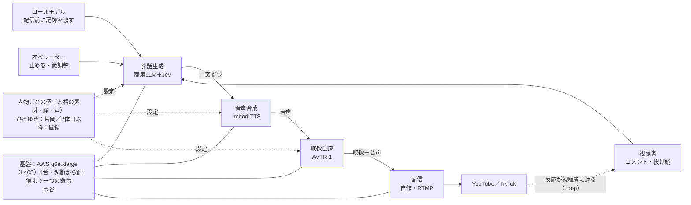

# 片岡HD 技術ロードマップ

10/18の初配信までに作った仕組みを土台に，担当を分けて，2027年6月の「3体で配信」まで進める計画です．

- 2026年10月24日版（片岡くんの計画資料「AI配信者」10/20を反映）．たたき台です．担当は次回のミーティングで確定します
- Slack: #20-pj-kataoka-hd ／ メンバー向け資料
- 関連：[資金ロードマップ](funding-roadmap.md)，[コンテンツロードマップ](content-roadmap.md)

## まず押さえること

- **仕組みはすでに動いています．** AWSのGPU1台で，コメントから配信までを実時間より速く回せます．10/18には1時間34分の初配信を落ちずに終えました．
- **次の課題は，開発が片岡くんに集中していることです．** エンジンは片岡くんが持ち，「回す」「人物を増やす」「企画する」を別の人が持ちます．
- **節目は4つです．** 10/31に2時間の通し，11/30に週3回×2時間を12回，1/31に収益化の入口，6/30に3体で配信．

> **次の節目：10/31** 2時間の通し配信と，TikTokの配信条件（フォロワー1,000人・スマホで30分の配信）を越える．

## いまの仕組み

3つのHuman in the Loop（ロールモデル・オペレーター・視聴者）が発話生成に入り，音声合成 → 映像生成 → 配信の順に渡ります．人物ごとの値はコードから分けてあり，素材を置けば新しい人物も同じ手順で動きます．エンジン全体の設計は片岡くんです．

| 映像生成 | 音声合成 | 起動から配信 | 初配信（10/18） |
|---|---|---|---|
| **67コマ/秒**（AVTR-1．正面の画1枚から動かす） | **2–3倍速**（Irodori-TTS．実時間に対する速さ） | **15分**（AWS g6e.xlarge．一つの命令で） | **94分**（落ちず，音声と映像の遅れなし） |

### 設計：任せる範囲を分ける

| 役割 | 担うもの | 中身 |
|---|---|---|
| 流れ | コード | 何を軸に，いつそれ，いつ終えるか．値はひろゆき氏の実測から引く． |
| 文 | LLM | 一文ずつ書かせる．組み立てまで任せると，すぐ脇道へそれる． |
| 判断 | Jev | はい・いいえだけを聞く．「らしさ」の良し悪しは聞かない． |
| 知識 | RAG | 2字の並びで引き，Jevで絞る．LLMを替えても動く． |

- **顔：** 正面の画1枚から，0.2秒ごとに42の値で動かします．否定なら首を振る，疑問なら首をかしげるといった意味のしぐさと，まばたきや目の動きなどの自律の動きがあります．体と手はまだ止まっています．
- **人格の素材：** 映像は使わず，文字と音声，写真だけから作りました．配信アーカイブ77時間（28本），一人の雑談26,233文，投げ銭と答え367組，持論と体験のカード2,736枚，経歴と事実の百科9,000字，声の手本109秒です．

## 持ち場

片岡くんの計画資料の役割分担です．

| 担当 | 持ち場 | 中身 |
|---|---|---|
| 片岡くん | エンジンと研究 | AIひろゆきの改善と，人が要る所の研究（3つのHITL）．アーキテクトとして，部品間の取り決め・統合・レビューを持ちます． |
| 國領さん | 2体目以降の人物 | ひろゆき氏以外のAI配信者を，同じ手順で作ります（絵でもよい）． |
| 金谷くん | インフラと費用 | 本番の起動・停止・監視を持ち，安く安全に回します．1時間約1,000円の原価を下げます． |
| 佐藤くん | 配信の企画 | 伸びる生配信を考え，何を話すか・どんな企画にするかを決めます． |
| 中本さん＋川崎さん | SNSの運用 | 2人で1チーム．SNSの運営と，数字（SNS・原価・投げ銭）の週報を持ちます．詳しくは[コンテンツロードマップ](content-roadmap.md)． |

## 集中をほどく3つの仕組み

- **回すのは金谷くん．** 「起動から配信まで一つの命令」を金谷くんが引き継ぎ，本番の起動・停止・監視を持ちます．片岡くんがいなくても本番が回る状態にします．
- **人物を増やすのは國領さん．** 2体目を同じ手順で作ると，つまずいた所がそのまま手順書になります．6/30の節目「新しい人物を1週間・5万円で」の検証にもなります．
- **企画は佐藤くん．** 何を話すか，どんな企画にするかを片岡くんの手から外し，片岡くんはエンジンと研究に集中します．

### 片岡くんに用意してもらうもの

1. **構成図1枚：** 4つの段と，その間を流れるデータの形式
2. **README：** 起動・停止の方法，人物を追加する手順，必要な環境
3. **30分の画面録画：** 本番を立ち上げるまでの操作

構成図とREADMEの下書きは，Claude Codeでリポジトリから起こせば負担を小さくできます．コードは研究室のGitHubに集約し，タスクはGitHub Issuesで管理します．技術の定例は週1回30分，事業の打合せとは別に設けます．

## 技術ロードマップ

片岡くんの計画の節目に合わせています．フェーズ1・2は，資金ロードマップの関門1・2と同じ時期です．

| フェーズ | 時期 | ゴール | 終わりの目安 |
|---|---|---|---|
| 0. 2時間の通し（いまここ） | 〜2026年10月31日 | 2時間の通し配信．TikTokの配信条件を越える | 2時間を落ちずに流せる |
| 1. 週3回の本番（資金の関門1） | 2026年11〜12月 | 週3回×2時間の本番（11/30までに12回）．計測ログ，起動・停止を金谷くんへ，構成図とREADME，2体目の候補選び，非商用部品の置き換え先の調査 | 12回を落ちず間なく．**片岡くん抜きで1回本番を回せる** |
| 2. 収益化の入口と2体目（資金の関門2） | 2027年1〜3月 | 同時接続100・手取り1時間500円（1/31），メンバーシップ，2体目の許諾と公開，AVTR-1の非商用部品の置き換え，体と手の動き | 2体目が公開され，評価実験のデータで全国大会に発表できる |
| 3. 3体で配信（資金の関門3） | 2027年4〜6月 | 3体で配信（6/30），新しい人物を1週間・5万円で立ち上げる，英語での配信を試す，外に売る準備 | 3体が並行して配信できる |

## 技術の目標値

| 指標 | 現状（10/18） | 11月末 | 2027年6月末 |
|---|---|---|---|
| 連続配信 | 1時間34分 | 2時間×12回，落ちず間なく | 3体が並行 |
| 映像生成 | 毎秒67コマ | 維持 | 体と手を足しても実時間より速く |
| 起動から配信 | 15分・一つの命令（片岡くん） | 金谷くんが起動できる | 人物ごとに同じ手順 |
| 新しい人物の立ち上げ | ― | 2体目の候補を選ぶ | 1週間・5万円 |
| 1時間の原価 | 約1,000円 | 実測を続ける | 下げる |
| 片岡くん抜きの本番 | できない | 12月に1回できる | 担当者だけで定常運用 |

## 壁と代わりの道

- **非商用の部品：** AVTR-1に非商用の部品が残っています．収益化や販売の前に置き換えが必要です．
- **体と手：** 顔は動きますが，体と手はまだ止まっています．
- **長時間：** 2時間を超える配信はまだ測っていません．

節目を越えられなかったときの次の手も，先に決めておきます．

| 節目 | 越えられなかったら |
|---|---|
| TikTokの条件（10/31） | 11月はYouTubeだけで流し，ショートで人を集める |
| 週3回の本番（11/30） | 体を増やさず，12月は1体の質と運用を直す |
| 収益化の入口（1/31） | 配信を減らして費用を下げ，自前の売り場を先に作る |
| 3体で配信（6/30） | 外に売るのを遅らせ，7〜9月を制作の自動化に使う |

## 前提にすること

- **生成系のサービスは，各サービスの利用規約の範囲で使います．** 規約の抜け道に頼る構成は，事業化や審査で必ず問題になります．
- **研究用のログは共有の場所に置きます．** 個人のPCだけに残すと研究データとして使えないので，アクセス管理を付けて共有します．
- **実在の人物は，書面の許諾の範囲でだけ使います．** 2体目以降は，権利を自前で持てる人物を優先します．

## 次のアクション

担当は案です．次回のミーティングで確定させてください．

| 担当 | 内容 | 期限 |
|---|---|---|
| 片岡くん | 構成図・README・30分の画面録画を用意する（Claude Codeで下書き） | 11月上旬 |
| 金谷くん | 本番の起動・停止を引き継ぎ，原価を下げる案を出す | 11月中旬 |
| 佐藤くん | 11月の週3回の本番の企画を組む | 11月上旬 |
| 國領さん | 2体目の候補（架空の人物・絵・配信者）を挙げ，同じ手順で試作する | 12月 |
| 片岡くん | AVTR-1の非商用部品の置き換え先を調べる | 12月 |
| 全員 | コードを研究室のGitHubに集約し，Issuesでの管理を始める | 11月上旬 |
| 小板 | 持ち場と研究テーマを確定する | 次回MTG |

## 参照

片岡くんの計画資料「AI配信者 研究と事業化の計画」（2026年10月）．チャンネル内の議論：9/20，9/26，10/4，10/9，10/16のハドル議事録と各スレッド．
